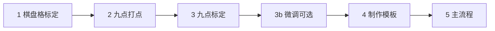

# 产线标定、模板与主流程部署指南

现场步骤以 **[产线视觉标定与主流程.md](产线视觉标定与主流程.md)** 为准；本文偏技术说明与 flow 索引。

本文说明从相机标定、PLC 坐标映射、HALCON 模板制作到主流程运行的推荐顺序。相关算子细节见 [chessboard/README.md](chessboard/README.md)、[halcon/README_coarse_fine_shape_match.md](halcon/README_coarse_fine_shape_match.md)。

---

## 部署顺序概览

流程页快捷（从左到右）：**主流程** → **棋盘格标定** → **九点打点** → **九点标定** → **微调**。



| 步骤 | 快捷按钮 | 目的 |
|------|----------|------|
| 1. 棋盘格标定 | **棋盘格标定** | 内参去畸变、透视展开；**选定一张正视角**作为后续 `viewIndex` |
| 2. 九点打点 | **九点打点** | 中心+步距生成九点世界坐标（`world_pos.txt`），供九点标定，不是量产焊 |
| 3. 九点标定 | **九点标定** | 像素坐标系 → PLC / 世界坐标系（仿射变换） |
| 3b. 微调 | **微调** | 对已保存仿射做平移/缩放，覆盖九点 JSON |
| 4. 制作模板 | — | 外框 / 粗匹配 / 精匹配 / 标定板 / 焊点 等 `.shm` / `.dfm` |
| 5. 主流程 | **主流程** | 加载标定结果，跑检测、匹配、轨迹下发 |

---

## 1. 棋盘格标定（去畸变 + 透视矫正）

**目标**：求相机内参、畸变系数及多视图外参，供后续 `intrinsics_undistort_image`、`chessboard_perspective_warp_image` 或 `calibration_correct_image` 使用。

**关键操作**：

1. 运行 [`v4/chessboard_intrinsics_from_dir.flow.json`](v4/chessboard_intrinsics_from_dir.flow.json)（见第 4 节），得到 `chessboard/calibration_result.json`。
2. 在标定成功的多张图中，**选一张棋盘放得较正、完整的图**，记下其在 `extrinsicsPerView` 中的 **`viewIndex`**（从 0 起，与标定成功图像顺序一致）。
3. 后续透视展开、组合矫正算子中 **`viewIndex` 固定使用该视角**；去畸变仅依赖内参，与 `viewIndex` 无关。

**采图要求**（目录内标定图）：

- 棋盘格**完整入画**，尽量在同一平面；
- 多张图**分布均匀、姿态多样**（俯仰、偏航变化）；
- **至少一张较正**，专门作为透视展开的参考视角。

**输出尺度**：产线推荐 **`perspectiveOutputFrame=plane`** + **`perspectiveOutputScale=board_pixels`**（默认）。多视角批处理若需固定物理尺寸小图，可改 `metric`。详见 [chessboard/README.md](chessboard/README.md)。

---

## 2. 九点标定（像素 → PLC 坐标系）

**目标**：建立图像像素 `(x, y)` 与 PLC / 机台世界坐标 `(X, Y)` 的仿射关系，供 `img_to_world`、`send_plc` 等使用。

**推荐顺序**：

1. 点快捷 **九点打点**，打开 [`v4/calibSendContour.flow.json`](v4/calibSendContour.flow.json)。机台确定 **中心点** 与 **stepXmm / stepYmm**，填入 **weld_trajectory_world**，生成 `v4/models/world_pos.txt`（详见 [产线视觉标定与主流程.md](产线视觉标定与主流程.md) 阶段 2）。  
2. 拍一张九点可见的标定图，点快捷 **九点标定**，用 [`v4/caliNinePoint.flow.json`](v4/caliNinePoint.flow.json)（圆点网格检测）求变换并保存 `models/calibration_nine_point.json`。  
   圆点检测专章 [v4/九点标定_圆点检测.md](v4/九点标定_圆点检测.md)。  
3. 整体平移/缩放仍偏时，点快捷 **微调**，打开 [`v4/adjustAffineCalibration.flow.json`](v4/adjustAffineCalibration.flow.json)，覆盖同一 JSON。不要把 `adjust_affine_calibration` 加回九点求解流程。

**注意**：

- `caliNinePoint` 里 **九点标定** 算子的 **`worldPoints`** 应与 `caliSendContour` 生成的世界坐标一致；
- **图上像素点顺序** 必须与 **世界坐标点顺序一一对应**（通常 3×3 从左到右、从上到下）；
- 运行 `caliNinePoint` 时若开启 `confirmCorrespondence`，可在对话框中核对像素点与世界点配对。

---

## 3. 制作模板（高级功能 → 形状模板）

菜单：**高级功能 ▾ → 形状模板**（`HalconShapeModelPage`）。

按用途制作多类模板，导出 `.shm`（刚性）或 `.dfm`（可变形），供流程中 `halcon_load_shape_model` / `halcon_load_deformable_model` 加载。

### 3.1 工件外框模板（方向粗定位）

| 项 | 说明 |
|----|------|
| **用途** | 确定工件**大致方向**，缩小后续匹配的角度搜索范围，减少误匹配、加快速度 |
| **轮廓** | 工件**外轮廓**或外框特征 |
| **角度** | 创建与匹配时 **角度范围要大**，须覆盖现场可能出现的**全部旋转** |
| **流程中** | 通常 angleStart / angleExtent 设得较宽；结果 `Angle` 供下游粗匹配参考 |

### 3.2 工件粗匹配模板（位置粗定位）

| 项 | 说明 |
|----|------|
| **用途** | 确定工件**位置**；精匹配 ROI 小、搜索可更「大胆」，若不在此步缩小角度/位置，精匹配误差会很大 |
| **轮廓** | 工件上**关键、稳定**的轮廓（重复性好、不易受光照影响） |
| **角度** | 相对外框模板已收窄，但仍需覆盖合理偏差 |
| **流程中** | 粗匹配 `Row/Col/Angle` → 精匹配 `CoarseRow/CoarseColumn/CoarseAngle` |

### 3.3 工件精匹配模板（轮廓生成）

| 项 | 说明 |
|----|------|
| **用途** | 生成贴合工件的**最终轮廓**（采样、轨迹、显示） |
| **轮廓** | **找准边缘**，阈值 / XLD 提取要稳定；轮廓质量直接决定轨迹是否贴合物体 |
| **类型** | 常为 **可变形模型 `.dfm`**，配合 `halcon_fine_deformable_match` |
| **详见** | [halcon/README_coarse_fine_shape_match.md](halcon/README_coarse_fine_shape_match.md) |

### 3.4 标定板模板（九点标定）

| 项 | 说明 |
|----|------|
| **用途** | 在标定图上定位九点标定板的圆心或特征点 |
| **示例** | `caliNinePoint` 子流程 [`findCircle.flow.json`](halcon/findCircle.flow.json) 加载 `shape_model_circle.shm`，网格排序后输出 9 个像素点 |
| **制作** | 在形状模板页用标定板圆点 / 十字制作模板，匹配参数与现场成像一致 |

### 3.5 焊点模板（九点标定）

| 项 | 说明 |
|----|------|
| **用途** | 定位激光焊接九点（或焊点阵列）在图像中的位置 |
| **与九点标定关系** | 像素点经九点标定变换后写入 PLC；与 3.4 类似，轮廓应对准**实际焊点成像** |

**模板文件位置**：建议放在与主 flow 同目录（如 `flows/halcon/shape_model.shm`），流程中用相对路径加载。

### 3.6 创建 vs 定位：角度范围、缩放范围与步长

两套都叫 AngleStart / AngleExtent（缩放同理 ScaleMin / ScaleMax），但不是一回事。

| | **创建**（写进 `.shm`） | **定位**（Find） |
|---|---|---|
| 角度 | 模板预存哪些旋转。0°=训练图朝向 | 这一次搜哪一段角。粗搜相对图像 0°；精搜相对 `CoarseAngle` |
| 缩放 | ScaledShape 预存哪些尺寸。刚性模型 Min=Max=1，无缩放格 | 这一次的 `scaleMin`/`scaleMax`，须 ⊆ 创建范围 |
| 改参数 | 须重新创建模型 | 只改流程/测试参数 |
| 约束 | 决定模型能覆盖的最大转角/尺寸 | 必须落在创建范围之内，可以更窄 |

创建 Start=−30、Extent=60 → 模型大约覆盖 −30°～+30°。定位可以只搜 ±2°；反过来创建只开 ±2°、定位要 ±30°，多出来的角找不到。缩放同理：创建 0.95～1.05，定位不能搜到 0.90。

**`angleStep` / `scaleStep` 都是创建采样网格**，不是最终角或尺寸只能精确到这一档。Find 不再另设步长，用写进 `.shm` 的格子。

| | **角度步长** | **缩放步长**（仅 ScaledShape） |
|---|---|---|
| 页上默认 | **0 = 自动**；流程创建默认 **0.5°** | **0 = 自动**。HALCON 按「模型半径上大约差 1 像素」选格，摘要里常见 **0.009～0.01** |
| SubPixel=`none` | 角停在格子上。0.5° 大约差 0.25°～0.5°；长约 40 mm 远端约 0.2～0.3 mm | 缩放停在格子上。0.009 大约差 **0.45%～0.9%**；相对匹配原点、长 40 mm 远端约 **0.18～0.36 mm** |
| `interpolation` / `least_squares` | 格子间拟合角 | 格子间拟合缩放 |
| 不要为精度去改 | 不必改到 0.1° | 不必改到 0.001 |

建议：创建步长保持 0（自动）或现有 0.5° / 自动缩放格；粗匹配可 `none`；精匹配用 `least_squares` 或至少 `interpolation`。精匹配也用 `none` 时，才是这些步长在限制精度。

### 3.7 ROI 绘制、保存与加载

完整操作说明：[halcon/README_shape_model_roi.md](halcon/README_shape_model_roi.md)。  
联调测试方案（ROI 编辑、生成模型、运行模板测试流程）：[halcon/README_shape_model_page_test.md](halcon/README_shape_model_page_test.md)。

有九点标定时，ROI **全程 mm**（编辑、存盘），**只有叠图和创建模板时换成像素**。没有九点则不能保存为 mm。建议放到配方 `roi/*.xvroi.json`，并与参数配方对应：`outline` / `coarse` / `fine`。切换参数配方时自动加载已保存的对应文件。

加载图像、相机单帧采集**不清 ROI**。矩形/圆：无 ROI 时按下拖、松开即画出。形状模板页工具栏有随模式变化的 ROI 编辑提示，**编辑说明** 可看当前形状怎么画、怎么改。画线/取点时普通单击是加点；要选已有边请 **`Alt`+点**。开放轨迹 `Delete` 只删该边（中间边拆成两条），`Shift+Delete` 才拼接缺口。`Ctrl`+拖整体平移。

mm↔像素固定保持平行（无界面开关），`PreserveRoiAngle` 一律为 `true`。

| | **保存** | **加载** |
|---|---|---|
| 文件 | `Version=2`，`CoordinateUnit=mm`，几何为世界坐标；默认 `roi/outline.xvroi.json` 等 | 按 `Version` / `CoordinateUnit` 判断；v1 或缺字段当像素 |
| 前提 | 有效九点；已有矩形/圆/多边形/环形/开放轨迹 | mm 文件同样需要九点 |
| 九点路径 | 写入当时的九点 JSON（参考） | **优先配方** `camera_correction.json`；配方为空才用文件内路径 |
| 保持平行 | 写入 `PreserveRoiAngle=true` | 一律按保持平行换算 |
| 图像 | 写入关联 `ImagePath` 与宽高 | 手动加载时可询问是否打开关联图；切参数配方不换图 |
| 开放轨迹 | 未「完成本条」会问是否先并入 | 恢复多条路径、名称、连接线（连接线不进模板） |

不要把 mm 文件再当像素转一次，否则叠图会错位或尺度差一个仿射倍数。

---

## 4. 流程文件说明

### 4.1 `v4/chessboard_intrinsics_from_dir.flow.json`（产线）

> 历史副本：`chessboard/chessboard_intrinsics_from_dir.flow.json`；**现场以 v4 为准**。

| 项 | 说明 |
|----|------|
| **输入** | 参数 `imageDirectory`：标定图目录（可配合 `namePrefix`、`extensions` 过滤） |
| **输出** | `CalibrationJson`（含质检字段）→ `display_calibration` / `save_calibration_result` |
| **质检** | 同文件含角点逐张检查、去畸变对比支路；详见 [chessboard/README.md](chessboard/README.md#标定质检自动判级--目视支路) |
| **采图** | 棋盘完整、共面、姿态多样；**其中一张要较正**，记下其 `viewIndex` 供透视展开 |
| **算子参数** | `cols` / `rows` / `squareSizeMm` 须与物理棋盘一致 |

### 4.2 `v4/calibSendContour.flow.json`（快捷 **九点打点**）

> 历史副本：`halcon/caliSendContour.flow.json`。产线文件名是 **`calibSendContour.flow.json`**。

| 项 | 说明 |
|----|------|
| **用途** | 为九点标定**打世界坐标点**：中心+步距生成 3×3 `world_pos.txt`。可选再经 PLC 走一圈九点轨迹核对。**不是**量产焊接主流程 |
| **使用前** | 修改 **weld_trajectory_world**：**中心点**（`centerX` / `centerY` / `centerZ`）、**步距**（`stepXmm` / `stepYmm`）、**绕中心旋转**（`rotateDeg`）与现场九点布局一致 |
| **输出** | `models/world_pos.txt`；供 `caliNinePoint` 的 `worldPointsFile` |

### 4.3 `v4/caliNinePoint.flow.json`（快捷 **九点标定**）

> 历史 HALCON 圆点链：`halcon/caliNinePoint.flow.json` + `findCircle.flow.json`；产线改用 **detect_calibration_dots**。本流程**不含**仿射微调。

| 项 | 说明 |
|----|------|
| **用途** | 计算**九点标定**仿射参数并保存 JSON |
| **输入** | 标定图 + `detect_calibration_dots` 输出的像素点 + 阶段 2 的 `world_pos.txt` |
| **worldPoints** | 由快捷 **九点打点** 生成；**顺序与像素点一一对应** |
| **输出** | `save_calibration_result` → `models/calibration_nine_point.json` |
| **核对** | `confirmCorrespondence=true` 时可交互确认像素↔世界配对 |

### 4.3b `v4/adjustAffineCalibration.flow.json`（快捷 **微调**）

| 项 | 说明 |
|----|------|
| **用途** | 读取已保存九点 JSON，对话框平移/缩放后**覆盖**写回 |
| **输入** | `models/calibration_nine_point.json`（可选标定图、世界点作预览/缩放中心） |
| **时机** | 九点求解已保存、整体偏差仍在时；不要嵌回 `caliNinePoint` |

### 4.4 `v4/main.flow.json`（快捷 **主流程**）

> 历史副本：`halcon/main.flow.json`。

| 项 | 说明 |
|----|------|
| **用途** | **主流程**：图像采集 → 预处理 → 粗/精匹配 → 轮廓采样 → 像素转世界 → PLC 下发 |
| **标定加载** | `load_calibration_result` 加载九点标定文件；棋盘 `CalibrationJson` 在矫正链中单独加载 |
| **子流程** | `grayPreprocess`、`binPreprocess`、`contourPreprocess`、`genMask` 等组合算子，按产线调整 |
| **PLC** | `plc_connect` → `send_plc`（`splitByBar=separate_batch`）→ 使能 / 等待焊完 |

更细的 HALCON 匹配说明：[README_shape_model_match.md](halcon/README_shape_model_match.md)、[README_coarse_fine_shape_match.md](halcon/README_coarse_fine_shape_match.md)。

---

## 5. 推荐串联关系（简图）

```
chessboard_intrinsics_from_dir  →  CalibrationJson  →  图像采集 → calibration_correct_image（viewIndex=正视角）
load_calibration_result         →  Transform         →  img_to_world → send_plc

形状模板页导出 .shm / .dfm  →  main.flow.json 内 halcon_load_* → 粗找 → 精找 → 轨迹
```

---

## 6. 常见问题

**Q: 透视图大小随 viewIndex 变化？**  
A: 使用 `perspectiveOutputScale=metric`；并确保 `viewIndex` 对应「较正」那张标定图。

**Q: 九点标定重投影误差大？**  
A: 检查 `worldPoints` 是否与快捷 **九点打点**（`calibSendContour`）生成的 `world_pos.txt` 一致；像素 9 点顺序是否与 3×3 网格一致。整体平移/缩放仍偏时用快捷 **微调**。

**Q: 如何查看棋盘格 + 九点的系统整体误差？**  
A: 九点标定算子填写 `calibrationJsonFile`（或连接棋盘 `CalibrationJson`），运行后对话框末尾有 **[系统整体误差]** 段；`SystemErrorJson` 接 `save_calibration_result` 会写入 `systemError` 字段（合成 avg/max，单位 mm）。

**Q: 精匹配偏差大？**  
A: 确认粗匹配已缩小位置/角度；精模板边缘是否贴合物体；Mask / `CoarseAngle` 是否接入。

**Q: 九点打点（calibSendContour）子流程路径无效？**  
A: 将 `innerFlowPath` 改为相对该 flow 的路径，并配置其中的 `weld_trajectory_world`（`centerX/Y`、`stepXmm/stepYmm`）。
